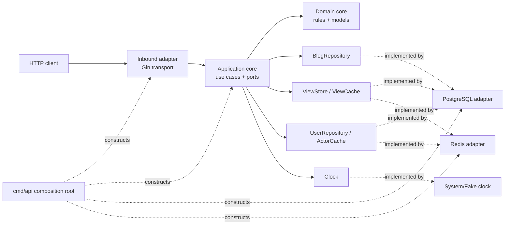
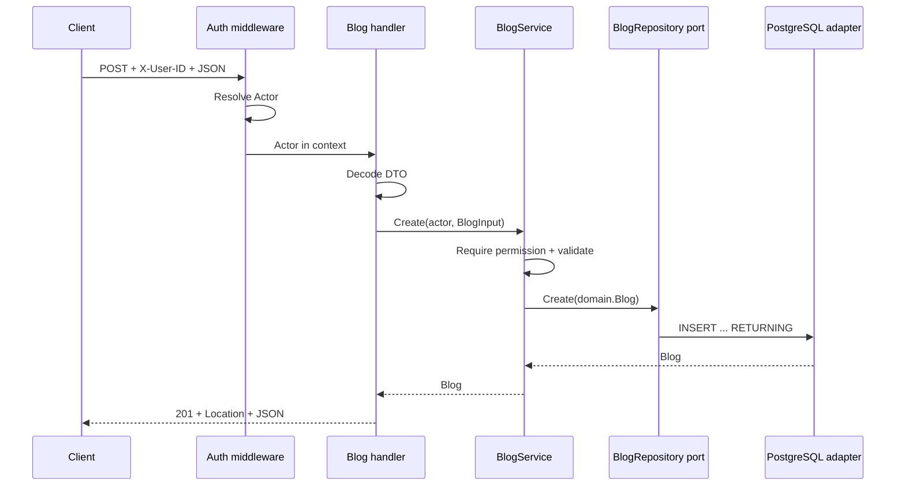
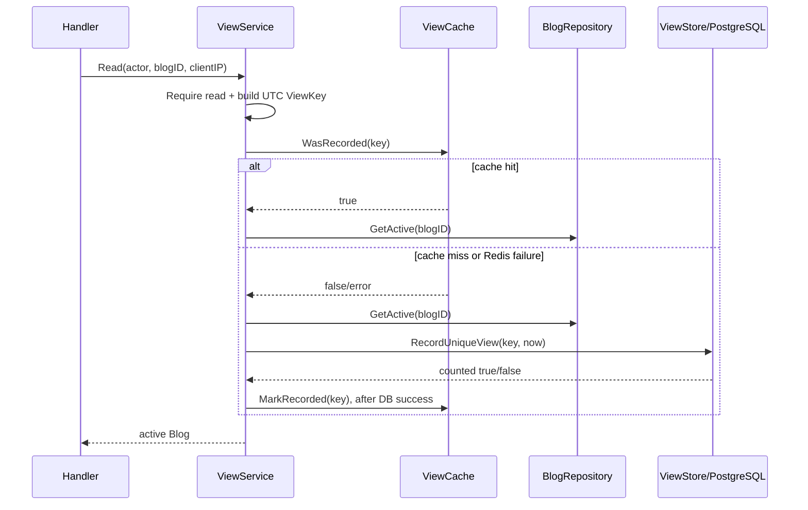

# Hexagonal Architecture in Blog Service

This document explains the project's architecture, the role of each package, dependency
direction, and the path an HTTP request takes through the system.

> In one sentence: HTTP, PostgreSQL, and Redis remain outside the business core;
> `domain` and `app` contain the business behavior; ports define communication
> boundaries; and `cmd/api/main.go` assembles concrete implementations.

## 1. Problem scope

Blog Service provides six primary APIs:

| Method | Endpoint | Use case |
|---|---|---|
| `GET` | `/api/v1/blogs` | List active blogs |
| `GET` | `/api/v1/blogs/:id` | Read details and record a unique daily view |
| `POST` | `/api/v1/blogs` | Create a blog |
| `PUT` | `/api/v1/blogs/:id` | Update a blog with optional optimistic locking |
| `DELETE` | `/api/v1/blogs/:id` | Soft delete a blog |
| `GET` | `/api/v1/reports/blogs` | Export up to 10 newest active blogs as CSV |

Important business requirements include:

- Role-based access for `admin`, `editor`, `reader`, `reporter`, and anonymous callers.
- One IP increments a blog's view count at most once per UTC day.
- PostgreSQL is the source of truth; Redis is an optional derived cache.
- Soft-deleted blogs disappear from detail, list, update, delete, and report flows.
- Reports stream directly instead of accumulating the entire result in memory.
- Time and client IP addresses are normalized for consistency and testability.

Putting these responsibilities directly in handlers or repositories would tightly
couple business behavior to Gin, PostgreSQL, and Redis. Hexagonal Architecture keeps
the business rules independent from those technologies.

## 2. What is Hexagonal Architecture?

Hexagonal Architecture is also known as **Ports and Adapters Architecture**. The system
is divided into three conceptual regions:

1. **Core**: models, business rules, and application use cases.
2. **Ports**: contracts the core provides or consumes.
3. **Adapters**: HTTP, PostgreSQL, Redis, and test implementations of those contracts.

The name does not require exactly six sides. The hexagon emphasizes that an application
may be driven or connected from multiple directions without leaking technology details
into the core.



### The key rule: dependencies point inward

```text
transport/http ──▶ app ──▶ domain
adapter/postgres ─▶ app ──▶ domain
adapter/redis ────▶ app ──▶ domain
```

- `domain` knows nothing about Gin, HTTP, pgx, or Redis.
- `app` knows the domain and declares the interfaces it needs.
- Adapters depend on application interfaces; the application does not depend on
  adapters.
- `cmd/api` may know every concrete type because its job is system assembly.

This is **Dependency Inversion**: a use case calls an interface owned by the application
layer rather than a concrete PostgreSQL implementation.

## 3. Mapping packages to the hexagon

| Region | Package | Responsibility |
|---|---|---|
| Domain core | [`internal/domain`](internal/domain) | Models, validation, permissions, view keys, and shared errors |
| Application core | [`internal/app`](internal/app) | Use cases, authorization, orchestration, and ports |
| Inbound adapter | [`internal/transport/http`](internal/transport/http) | Router, middleware, DTOs, handlers, and HTTP error mapping |
| Outbound adapter | [`internal/adapter/postgres`](internal/adapter/postgres) | pgx and hand-written SQL implementations of persistence ports |
| Outbound adapter | [`internal/adapter/redis`](internal/adapter/redis) | Redis implementations of optional cache ports |
| Outbound adapter | [`internal/adapter/clock`](internal/adapter/clock) | System clock implementation of the application clock port |
| HTTP support | [`internal/transport/http/clientip`](internal/transport/http/clientip) | Trusted-proxy-aware client IP resolution |
| Configuration | [`internal/config`](internal/config) | Environment loading and validation |
| Composition root | [`cmd/api/main.go`](cmd/api/main.go) | Dependency construction, server lifecycle, and shutdown |
| Test adapters | [`internal/app/apptest`](internal/app/apptest) | In-memory port implementations for tests |

## 4. Domain core and business rules

The stable core lives in [`internal/domain`](internal/domain). It contains no HTTP code
and no database queries.

### 4.1 Blog model and validation

[`blog.go`](internal/domain/blog.go) defines:

- `Blog`: the complete record, including content, views, version, and audit fields.
- `BlogInput`: editable fields used by create and PUT.
- `BlogSummary`: the smaller list projection.
- `BlogPage` and `PageRequest`: pagination results and rules.
- `BlogInput.Validate()`: trimming, required fields, and Unicode length limits.

Validation belongs in the domain because the same use case could be called from HTTP,
a CLI, a message consumer, or a test. Business validation remains consistent when the
entry point changes.

### 4.2 Actors, roles, and permissions

[`auth.go`](internal/domain/auth.go) defines `Actor`, `Role`, `Permission`, and the
permission matrix:

| Actor | Read | Create | Update | Delete | Export |
|---|:---:|:---:|:---:|:---:|:---:|
| Admin | ✓ | ✓ | ✓ | ✓ | ✓ |
| Editor | ✓ | ✓ | ✓ |  |  |
| Reader | ✓ |  |  |  |  |
| Reporter | ✓ |  |  |  | ✓ |
| Anonymous | ✓ |  |  |  |  |

`Actor.Require(permission)` returns:

- `nil` when access is allowed;
- `ErrUnauthenticated` when an anonymous caller lacks the permission;
- `ErrForbidden` when an authenticated caller lacks the permission.

This prevents role checks from being duplicated across handlers.

### 4.3 Normalized view keys

[`view.go`](internal/domain/view.go) identifies a unique daily view with:

```text
(blog ID, UTC date, normalized client IP)
```

`NewViewKey` removes IPv6 zones, converts IPv4-mapped IPv6 addresses to IPv4, and uses
the UTC calendar date. Every adapter therefore receives the same canonical value.

### 4.4 Shared domain errors

[`errors.go`](internal/domain/errors.go) defines errors such as not found, forbidden,
and version conflict. Application services return these errors; the HTTP adapter maps
them to status codes and response envelopes. The core never needs to know about `404`,
`403`, or JSON.

## 5. Application layer: use cases and ports

The application layer in [`internal/app`](internal/app) answers **what the system does**,
not which SQL statement or response format it uses.

### 5.1 BlogService

[`blog_service.go`](internal/app/blog_service.go) coordinates:

- `Create`: authorize, validate, create a UUID v7, and assign audit timestamps.
- `Update`: authorize, validate, and pass an optional expected version to the repository.
- `Delete`: authorize and request a soft delete.
- `List`: authorize, validate pagination, and fetch `limit + 1` rows to compute
  `has_next` without `COUNT(*)`.

The service knows only `BlogRepository` and `Clock`. It does not know whether data lives
in PostgreSQL, memory, or an external service.

### 5.2 ViewService

[`view_service.go`](internal/app/view_service.go) reads blog details and records unique
daily views through three ports:

- `BlogRepository`: load an active blog.
- `ViewStore`: atomically persist a unique view in the source of truth.
- `ViewCache`: skip work when a committed marker already exists.

Separating `ViewService` from `BlogService` keeps CRUD concerns independent from the
concurrency, date, IP, and caching rules of view counting. `ViewStore` is also separate
from `BlogRepository` because “atomically record a unique view” is a distinct capability.

### 5.3 ReportService

[`report_service.go`](internal/app/report_service.go) checks export permission before
asking the repository to emit `ReportRow` values through a callback. CSV belongs to the
HTTP adapter, so the application layer remains format-agnostic.

### 5.4 Ports

[`ports.go`](internal/app/ports.go) declares small interfaces at the point of use:

| Port | Application requirement | Production adapter |
|---|---|---|
| `BlogRepository` | Create/get/list/update/delete/stream blogs | `postgres.BlogRepo` |
| `ViewStore` | Atomically record a unique view | `postgres.ViewStore` |
| `ViewCache` | Read/write committed view markers | `redis.ViewCache` |
| `UserRepository` | Resolve an actor from a user ID | `postgres.UserRepo` |
| `ActorCache` | Cache successful actor lookups | `redis.ActorCache` |
| `Clock` | Supply the current time | `clock.System` |

Small consumer-owned interfaces clarify dependencies and make fakes straightforward.

## 6. Inbound adapter: HTTP transport

[`internal/transport/http`](internal/transport/http) translates external HTTP input into
application calls.

### 6.1 Router and middleware

[`router.go`](internal/transport/http/router.go) maps endpoints and installs middleware
in this order:

```text
recover → request-id → access log → CORS → client-ip → mock auth → handler
```

`/healthz` and `/readyz` sit outside the API group, so they do not require authentication
or client IP resolution. CORS is global: it adds headers to API and health responses and
terminates `OPTIONS` preflight requests before authentication and application handlers.

### 6.2 Handlers and DTOs

[`handler/blog.go`](internal/transport/http/handler/blog.go) performs HTTP-specific work:

- Parse path and query parameters.
- Decode JSON into request DTOs.
- Retrieve the `Actor` and client IP from request context.
- Call an application service.
- Convert results into status codes, headers, and JSON responses.

Handlers contain neither SQL nor the unique-view algorithm. POST and PUT perform an
early permission check before reading a potentially large body, while application
services still repeat the check so the rule is not tied to HTTP.

[`handler/report.go`](internal/transport/http/handler/report.go) converts `ReportRow`
values to CSV, neutralizes spreadsheet formula injection, and flushes in batches.

### 6.3 Mock authentication

[`middleware/auth.go`](internal/transport/http/middleware/auth.go) authenticates and
restores an actor; it does not authorize individual use cases:

```text
No X-User-ID           → Anonymous
Malformed X-User-ID    → 401
Redis actor cache hit  → store Actor in context
Cache miss/failure     → UserRepository.GetByID from PostgreSQL
Known user             → cache Actor and store it in context
Unknown user           → 401
```

The role always comes from the server. Application services later authorize with
`Actor.Require(...)`.

### 6.4 HTTP error mapping

[`httpx/errors.go`](internal/transport/http/httpx/errors.go) maps domain and
infrastructure errors to a consistent HTTP envelope. Keeping this mapping at the system
boundary preserves the core's independence from HTTP.

## 7. PostgreSQL outbound adapter

[`internal/adapter/postgres`](internal/adapter/postgres) implements persistence ports
with pgx and hand-written SQL.

### 7.1 BlogRepo

[`blog_repo.go`](internal/adapter/postgres/blog_repo.go) ensures:

- Every public read and update filters `deleted_at IS NULL`.
- Updates increment `version` and may validate an expected version.
- Deletes set `deleted_at` and `deleted_by` instead of removing rows.
- Lists use stable ordering: `created_at DESC, id DESC`.
- Reports stream rows and currently return at most 10 active blogs.
- pgx errors are converted into domain or infrastructure errors.

### 7.2 ViewStore and concurrency correctness

[`view_store.go`](internal/adapter/postgres/view_store.go) uses one SQL statement with
CTEs:

1. Select the active blog, filtering out missing or soft-deleted rows.
2. Run `INSERT ... ON CONFLICT DO NOTHING` in `blog_daily_views`.
3. Increment `blogs.views` only when the insert succeeds and the blog is still active
   (`deleted_at IS NULL`).

The primary key is:

```text
(blog_id, view_date, ip_address)
```

This is the correctness primitive. Concurrent identical requests can insert only one
row and increment the counter only once. Correctness does not depend on process memory
or a Redis lock.

### 7.3 UserRepo

[`user_repo.go`](internal/adapter/postgres/user_repo.go) resolves the actor and role from
the `users` table for mock authentication.

## 8. Redis outbound adapter

Redis is a **derived cache**, not the source of truth. Leaving `REDIS_ADDR` empty disables
Redis without changing correctness.

### 8.1 ActorCache

[`actor_cache.go`](internal/adapter/redis/actor_cache.go) caches actors already confirmed
by PostgreSQL. Cache misses and failures fall back to `UserRepository`; unknown users
are not cached.

### 8.2 ViewCache

[`view_cache.go`](internal/adapter/redis/view_cache.go) runs a Lua script through
`EVALSHA/EVAL` to check whether a committed marker exists. Redis keys contain a hash of
the client IP rather than the raw address.

Write ordering is essential:

```text
PostgreSQL RecordUniqueView succeeds → Redis MarkRecorded
```

Redis must never be marked first. Otherwise a failed database write could leave a cache
marker that suppresses a view that was never committed.

When Redis fails:

- Actor cache failure → read the user from PostgreSQL.
- View cache failure → execute the atomic PostgreSQL view statement.
- The API remains correct; only cache performance is lost.

## 9. Technical adapters

### 9.1 Clock

[`internal/adapter/clock/clock.go`](internal/adapter/clock/clock.go) provides:

- `System`: the production UTC clock.
- `Fake`: a clock tests can `Set` or `Advance`.

Application code does not call `time.Now()` directly, making UTC date boundaries, audit
timestamps, and report filenames deterministic in tests.

### 9.2 Client IP resolver

[`internal/transport/http/clientip/clientip.go`](internal/transport/http/clientip/clientip.go)
processes `X-Forwarded-For` according to trusted proxy rules. When the direct peer is not
trusted, forwarded headers are ignored to prevent IP spoofing and view fraud.

## 10. Composition root and dependency injection

[`cmd/api/main.go`](cmd/api/main.go) is the only composition root. It:

1. Loads configuration.
2. Creates logging and shutdown contexts.
3. Connects to PostgreSQL.
4. Creates a Redis client when configured.
5. Constructs concrete adapters.
6. Injects adapters into application services.
7. Injects services into the HTTP router.
8. Runs the server and performs graceful shutdown.

The wiring can be summarized as:

```text
postgres.BlogRepo ──▶ BlogService
postgres.BlogRepo + postgres.ViewStore + redis.ViewCache ──▶ ViewService
postgres.BlogRepo ──▶ ReportService
postgres.UserRepo + redis.ActorCache ──▶ MockAuth middleware
services + middleware dependencies ──▶ Router ──▶ HTTP Server
```

The project uses plain Go constructor injection. Compile-time checks such as
`var _ app.ViewStore = (*ViewStore)(nil)` verify that adapters continue to satisfy
their ports.

## 11. Request flows

### 11.1 POST `/api/v1/blogs`



JSON belongs to transport, `BlogInput` and validation belong to the core, and SQL
belongs to the outbound adapter.

### 11.2 GET `/api/v1/blogs/:id`



Even on a cache hit, the service calls `GetActive` so a recently deleted blog returns
`404` rather than stale data.

### 11.3 GET `/api/v1/reports/blogs`

```text
Request
  → middleware creates Actor
  → ReportService checks report:export
  → BlogRepository reads up to 10 active rows
  → callback converts each row to CSV
  → csv.Writer writes directly to the response
```

Permission is checked before the first CSV byte. If an error occurs after streaming has
started, the connection is aborted so the client cannot mistake a truncated file for a
complete report.

## 12. Testing in Hexagonal Architecture

### Unit tests

[`test/unit`](test/unit) runs the real router and services with in-memory adapters from
[`internal/app/apptest/fakes.go`](internal/app/apptest/fakes.go). Unit tests cover:

- Input validation.
- Permission matrices.
- HTTP status codes and response bodies.
- Use-case behavior without PostgreSQL or Redis.
- CORS and preflight behavior.

Fakes are not an architectural shortcut; they are alternative adapters implementing the
same ports.

### Integration tests

[`test/integration`](test/integration) exercises the APIs through production PostgreSQL
adapters and the current schema. Tests do not truncate the database and clean up only
the blogs they create. They cover SQL, row and error mapping, soft delete, optimistic
locking, unique constraints, concurrent views, the view/delete race, and CSV output.

### Load tests

[`loadtest/k6`](loadtest/k6) drives the service through the HTTP boundary like a real
client. It measures latency, throughput, dropped iterations, and system limits; it does
not replace unit or integration testing.

## 13. Why this is Hexagonal Architecture

The project demonstrates the defining traits:

- The core is independent from frameworks and databases.
- Ports are declared in the application layer.
- HTTP is an inbound adapter; PostgreSQL and Redis are outbound adapters.
- Concrete dependencies are assembled at the composition root.
- Test fakes can replace production adapters.

Directory names alone do not make the architecture. Dependency direction is decisive:
the core declares its ports, adapters implement them, and `cmd/api` chooses concrete
implementations.

## 14. Benefits and trade-offs

### Benefits

- Business logic is not locked to Gin, pgx, or Redis.
- Unit tests are fast because adapters can be replaced with fakes.
- Redis can be disabled or replaced without changing use cases.
- Boundaries and responsibilities are explicit.
- Authorization is applied consistently in the application layer.
- PostgreSQL preserves view-count correctness across multiple API instances.

### Trade-offs

- More interfaces, constructors, and mappings than a small handler-first CRUD service.
- Dependency direction requires discipline.
- Ports that are too large are hard to fake; ports that are too fragmented complicate
  wiring.
- Hexagonal Architecture does not automatically solve consistency or performance; SQL
  and cache strategies still require careful design.

For this project, permissions, unique views, cache fallback, soft deletion, and
testability provide enough complexity to justify the separation.

## 15. Extending the architecture

For a new “publish blog” use case:

1. Add status and rules to `domain` when they are business rules.
2. Add an application method or a focused new service.
3. Declare a small port in `app/ports.go` when new persistence behavior is required.
4. Implement the port in `adapter/postgres`.
5. Add DTOs, handlers, and routes in `transport/http`.
6. Wire dependencies in `cmd/api/main.go`.
7. Write unit tests with fake ports, then integration tests for real SQL.

A CLI would be another inbound adapter reusing existing application services. A new
storage technology would be another outbound adapter implementing the same ports.

## 16. Conclusion

The project places business rules in `domain` and `app`, uses ports to describe required
capabilities, and implements those ports through HTTP, PostgreSQL, Redis, and test
adapters. `cmd/api` assembles the system. This dependency direction keeps business logic
testable, preserves correctness when Redis fails, and limits the impact of technology
changes at the boundaries.
