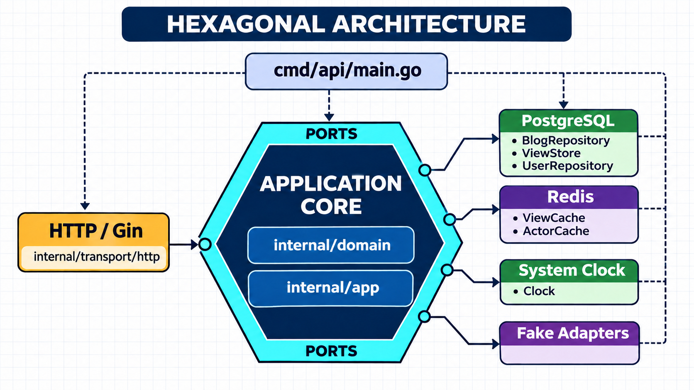
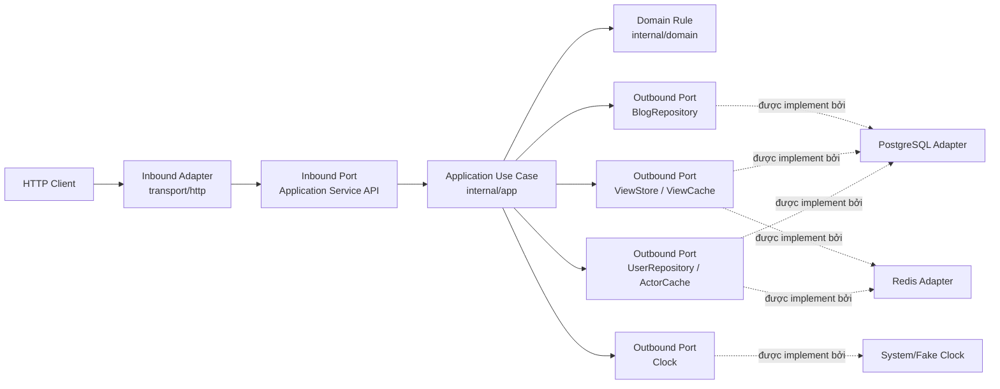
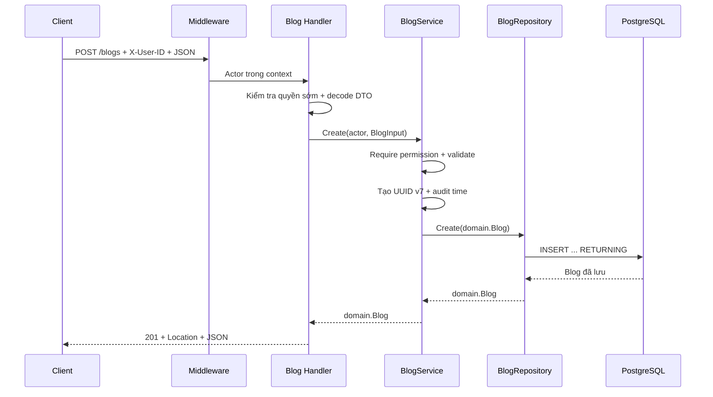
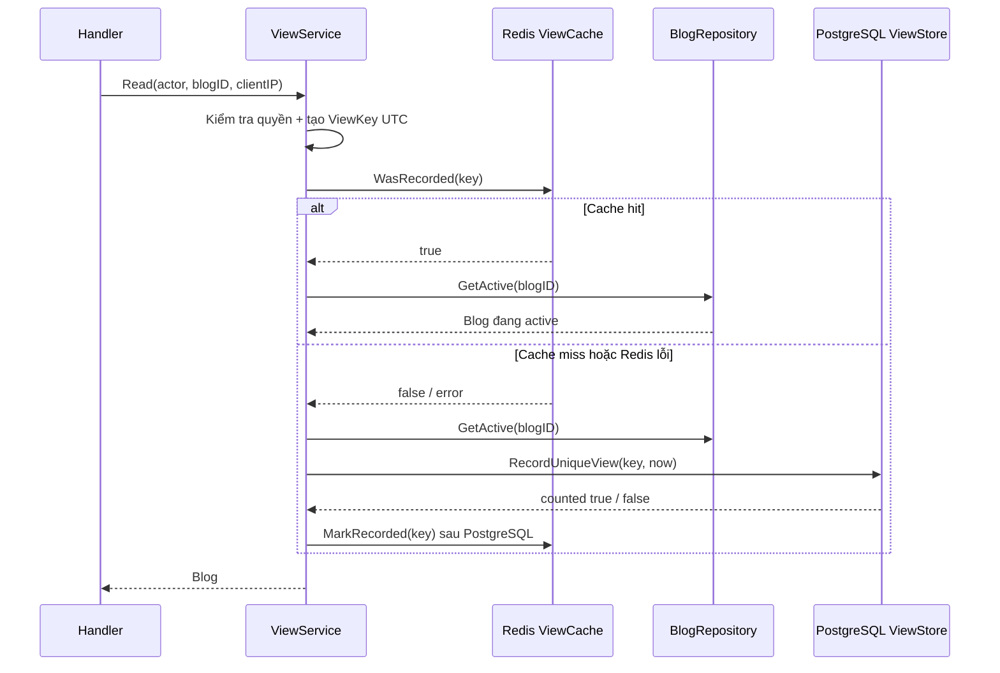

# Bài thuyết trình: Blog Content Service

## 1. Mở đầu

Blog Content Service là REST API viết bằng Go, phục vụ các nghiệp vụ:

- Tạo, xem danh sách, xem chi tiết, cập nhật và xóa mềm bài viết.
- Phân quyền theo vai trò `admin`, `editor`, `reader`, `reporter` và người dùng ẩn danh.
- Xuất danh sách bài viết ra CSV.
- Đếm lượt xem duy nhất theo bài viết, địa chỉ IP và ngày UTC.
- Dùng PostgreSQL làm nguồn dữ liệu chuẩn.
- Dùng Redis như bộ nhớ đệm tùy chọn, không quyết định tính đúng đắn của dữ liệu.

Điểm chính của dự án không chỉ là CRUD. Dự án còn giải quyết các vấn đề backend thực tế:

- Tách nghiệp vụ khỏi framework HTTP và cơ sở dữ liệu.
- Giữ bộ đếm view đúng khi có nhiều request đồng thời hoặc nhiều instance API.
- Không làm mất dữ liệu khi Redis gặp lỗi.
- Xử lý soft delete, optimistic locking và streaming CSV.
- Cho phép unit test chạy nhanh bằng fake adapter nhưng vẫn có integration test với PostgreSQL thật.

Thông điệp xuyên suốt:

> Gin, PostgreSQL và Redis nằm ở biên hệ thống; nghiệp vụ nằm trong `domain` và `app`; `cmd/api` lắp ráp toàn bộ thành một chương trình có thể chạy.

---

## 2. Phạm vi API

Hệ thống có sáu API nghiệp vụ:

| Phương thức | Endpoint | Chức năng |
|---|---|---|
| `GET` | `/api/v1/blogs` | Lấy danh sách bài viết đang hoạt động |
| `GET` | `/api/v1/blogs/:id` | Xem chi tiết và ghi nhận lượt xem duy nhất trong ngày |
| `POST` | `/api/v1/blogs` | Tạo bài viết |
| `PUT` | `/api/v1/blogs/:id` | Thay thế nội dung có thể chỉnh sửa, hỗ trợ optimistic locking |
| `DELETE` | `/api/v1/blogs/:id` | Xóa mềm bài viết |
| `GET` | `/api/v1/reports/blogs` | Xuất tối đa 10 bài viết mới nhất ra CSV |

Hai endpoint vận hành:

| Endpoint | Ý nghĩa |
|---|---|
| `GET /healthz` | Liveness: tiến trình API còn chạy |
| `GET /readyz` | Readiness: API có kết nối được PostgreSQL hay không |

`GET /api/v1/blogs` không tăng view. Chỉ `GET /api/v1/blogs/:id` mới đi qua luồng ghi nhận view.

---

## 3. Công nghệ sử dụng

| Thành phần | Công nghệ | Vai trò |
|---|---|---|
| Ngôn ngữ | Go | Xây dựng API và use case |
| HTTP framework | Gin | Router, middleware và HTTP context |
| Cơ sở dữ liệu | PostgreSQL 18 | Nguồn dữ liệu chuẩn |
| PostgreSQL client | pgx/v5 | Connection pool và truy vấn SQL |
| Cache | Redis 8 | Cache actor và marker view đã commit |
| Migration | Goose | Quản lý thay đổi schema |
| API contract | OpenAPI | Đặc tả endpoint và schema |
| Logging | `log/slog` | Structured JSON log |
| Đóng gói | Docker, Docker Compose | Môi trường chạy tái lập được |
| Kiểm thử tải | k6 | Đo throughput, latency và tỉ lệ lỗi |

Project chủ động dùng SQL viết tay. Các thao tác quan trọng như soft delete, optimistic locking và atomic unique view vì thế được thể hiện rõ trong source.

---

## 4. Khởi tạo source bằng Go Blueprint

### 4.1 Go Blueprint là gì?

[Go Blueprint](https://go-blueprint.dev/) là công cụ tạo bộ khung dự án Go. Giao diện web cho phép chọn framework, database, Git và các tính năng nâng cao; sau đó sinh câu lệnh CLI cùng cây thư mục dự kiến.

Công cụ giúp rút ngắn phần khởi tạo:

- Tạo Go module và cấu trúc project.
- Tạo entry point trong `cmd/api/main.go`.
- Tạo HTTP server mẫu trong `internal`.
- Tích hợp framework được chọn.
- Tạo cấu hình database, Makefile và Docker nếu được chọn.
- Khởi tạo Git theo lựa chọn.

Cài đặt:

```bash
go install github.com/melkeydev/go-blueprint@latest
```

Hoặc trên máy có Homebrew:

```bash
brew install go-blueprint
```

### 4.2 Lựa chọn dùng cho project

Các lựa chọn tương ứng với nền tảng ban đầu:

- Tên project: `blog-service`.
- HTTP framework: Gin.
- Database driver: PostgreSQL.
- Tạo cấu hình Docker.
- Khởi tạo Git.

Câu lệnh tương ứng:

```bash
go-blueprint create \
  --name blog-service \
  --framework gin \
  --driver postgres \
  --advanced \
  --feature docker \
  --git commit
```

Có thể dùng giao diện tại `go-blueprint.dev` để chọn tùy chọn và lấy câu lệnh thay vì nhớ toàn bộ cờ CLI.

### 4.3 Bộ khung điển hình do Go Blueprint tạo

```text
blog-service/
├── cmd/
│   └── api/
│       └── main.go
├── internal/
│   ├── database/
│   └── server/
├── Dockerfile
├── docker-compose.yml
├── Makefile
├── go.mod
└── go.sum
```
---

## 5. Tại sao chia thành `cmd` và `internal`?

Hai thư mục được tách theo hai trách nhiệm khác nhau:

- `cmd` chứa **điểm chạy của chương trình**. Trong project này, `cmd/api/main.go` khởi động API và lắp ráp các dependency cần thiết. Nếu sau này có worker hoặc công cụ CLI, mỗi chương trình có thể có một thư mục riêng trong `cmd`.
- `internal` chứa **phần triển khai nội bộ của service**, gồm nghiệp vụ, use case, HTTP transport, PostgreSQL, Redis và cấu hình. Go cũng ngăn module bên ngoài import trực tiếp các package trong `internal`, giúp các chi tiết triển khai không trở thành API công khai.

Việc tách này giữ `main.go` gọn, tránh trộn logic khởi động với logic nghiệp vụ, đồng thời cho phép nhiều chương trình trong `cmd` dùng lại cùng phần lõi trong `internal`.

> Tóm lại: `cmd` trả lời “chạy chương trình nào?”, còn `internal` trả lời “chương trình đó hoạt động như thế nào?”.

---

## 6. Hexagonal Architecture trong project



*Kiến trúc tổng thể: application core chỉ giao tiếp qua ports; HTTP, PostgreSQL, Redis,
clock và test fake là các adapter được lắp ráp tại `cmd/api/main.go`.*

Hexagonal Architecture, còn gọi là Ports and Adapters Architecture. Mục tiêu chính là tách business logic khỏi HTTP framework, database, cache, thời gian hệ thống và các yếu tố hạ tầng khác.

### 6.1 Application Core — phần lõi của hệ thống

Trung tâm hình lục giác là `Application Core`, gồm hai phần:

- `internal/domain`: model và business rule như validation, permission, view key và
  domain error.
- `internal/app`: các application service điều phối domain rule để thực hiện use case
  tạo, đọc, cập nhật, xóa blog, ghi nhận view và xuất báo cáo.

Application Core không cần biết:

- Request đến từ Gin hay một HTTP framework khác.
- Dữ liệu được lưu bằng PostgreSQL, một database khác hay bộ nhớ trong test.
- Cache sử dụng Redis hay đang bị tắt.
- Thời gian đến từ đồng hồ hệ thống hay fake clock.

Ví dụ, `ViewService` chỉ yêu cầu một thành phần có khả năng ghi nhận unique view thông
qua `ViewStore`. Service không gọi `pgx`, không chứa câu SQL và không biết PostgreSQL
triển khai thao tác đó như thế nào.

### 6.2 Ports — hợp đồng giao tiếp với core

Port là hợp đồng tại ranh giới của Application Core, được phân loại theo hướng nhìn từ core:

- **Inbound port** mô tả các chức năng mà bên ngoài có thể yêu cầu application thực hiện.
  Các public method như `BlogService.Create`, `BlogService.Update`, `ViewService.Read`
  và `ReportService.Export` đóng vai trò application API/inbound port.
- **Outbound port** mô tả các khả năng application cần từ bên ngoài. Các interface
  `BlogRepository`, `ViewStore`, `ViewCache`, `UserRepository`, `ActorCache` và `Clock`
  được khai báo tại `internal/app/ports.go`.

Inbound port không bắt buộc phải là Go interface. Project dùng trực tiếp public method
của application service vì hiện tại HTTP là bên gọi các use case. Outbound port dùng
interface để core không phụ thuộc vào implementation PostgreSQL, Redis hoặc system clock.

### 6.3 Adapters — kết nối công nghệ bên ngoài với core

Adapter chuyển đổi giữa một công nghệ cụ thể và port của application:

| Adapter | Loại | Trách nhiệm | Port liên quan |
|---|---|---|---|
| `internal/transport/http` | Inbound | Đọc HTTP input, gọi use case, tạo HTTP response | Application service API |
| `internal/adapter/postgres` | Outbound | Lưu blog, user và unique view | `BlogRepository`, `UserRepository`, `ViewStore` |
| `internal/adapter/redis` | Outbound | Cache actor và marker view đã commit | `ActorCache`, `ViewCache` |
| `internal/adapter/clock` | Outbound | Cung cấp thời gian thật hoặc thời gian điều khiển được | `Clock` |
| `internal/app/apptest` | Outbound dùng khi test | Thay hạ tầng thật bằng implementation trong memory | Repository và store ports |

HTTP handler chỉ nên xử lý vấn đề của HTTP như path, query, header, body và status code.
Các rule như validation, permission hay cách ghi nhận unique view phải nằm trong
`domain` hoặc `app`, không phụ thuộc vào Gin handler.

### 6.4 Mock/Fake adapter trong Unit Test

Trong unit test, các adapter thật được thay bằng fake implement cùng port:

```text
Application Service
├── Production: PostgreSQL / Redis / System Clock
└── Unit test:  Repo / Views / Users / Fake Clock
```

Project cung cấp các implementation in-memory trong `internal/app/apptest`:

- `Repo` thay cho `BlogRepository`.
- `Views` thay cho `ViewStore` và vẫn mô phỏng việc loại bỏ view trùng.
- `Users` thay cho `UserRepository`.
- `clock.Fake` trả về thời điểm cố định hoặc có thể chủ động thay đổi.

Nhờ vậy, unit test có thể khởi tạo service và kiểm tra business logic mà không cần chạy
PostgreSQL, Redis hoặc HTTP server thật. Fake clock còn giúp kiểm tra logic phụ thuộc ngày
UTC một cách ổn định, không phải gọi trực tiếp `time.Now()` hoặc chờ thời gian thực.

Mock thường phù hợp khi cần xác nhận một dependency được gọi với đúng tham số. Fake là
một implementation đơn giản nhưng có hành vi đủ giống adapter thật để chạy use case.
Project chủ yếu dùng fake; vì thế test ít phụ thuộc chi tiết implementation hơn.

Fake không thay thế integration test. Unit test kiểm tra business rule và cách use case
điều phối port; integration test vẫn cần PostgreSQL và HTTP thật để kiểm tra SQL,
transaction, constraint và việc các adapter phối hợp với nhau.

### 6.5 Luồng thực thi của một request



Sơ đồ này thể hiện luồng gọi lúc runtime: request đi từ inbound adapter vào use case;
use case áp dụng domain rule rồi gọi ra ngoài qua outbound port. Luồng chạy có thể đi
ra adapter, nhưng dependency của source code vẫn luôn hướng vào Application Core.

---

## 7. Domain model và validation

### 7.1 Blog

`domain.Blog` giữ:

- Nội dung: title, author, content, description.
- Trạng thái: views, version.
- Audit: created/updated/deleted time và user.
- UUID v7 khi tạo qua API.

`BlogInput.Validate()`:

- Trim title và author.
- Kiểm tra required field.
- Đếm độ dài theo Unicode rune, không theo số byte UTF-8.
- Trả toàn bộ field lỗi trong một `ValidationError`.

Giới hạn ở domain được phản chiếu bằng `CHECK constraint` trong migration. Application cho thông báo lỗi thân thiện; database là lớp bảo vệ cuối.

### 7.2 Phân trang

`page` mặc định 1, `limit` mặc định 20 và tối đa 100.

Service lấy `limit + 1` dòng:

```text
Số dòng > limit → has_next = true → bỏ dòng dư
Số dòng ≤ limit → has_next = false
```

Cách này tránh `COUNT(*)` cho mỗi request list, đổi lại response không trả tổng số bản ghi.

### 7.3 Permission matrix

| Actor | Đọc | Tạo | Cập nhật | Xóa | Xuất CSV |
|---|:---:|:---:|:---:|:---:|:---:|
| Admin | ✓ | ✓ | ✓ | ✓ | ✓ |
| Editor | ✓ | ✓ | ✓ |  |  |
| Reader | ✓ |  |  |  |  |
| Reporter | ✓ |  |  |  | ✓ |
| Anonymous | ✓ |  |  |  |  |

Rule nằm tại `domain.Actor`; application service gọi `Require()`.

POST và PUT kiểm tra quyền sớm trước khi đọc body lớn, nhưng service vẫn kiểm tra lại để rule không bị bỏ qua nếu use case được gọi từ CLI hoặc worker.

---

## 8. Luồng HTTP và middleware

Thứ tự:

```text
recover
→ request-id
→ access log
→ CORS
→ client-ip
→ mock auth
→ handler
```

Ý nghĩa:

1. `recover`: chặn panic, ghi stack và trả lỗi chuẩn nếu response chưa bắt đầu.
2. `request-id`: dùng request ID hợp lệ từ client hoặc tạo token ngẫu nhiên.
3. `access log`: ghi method, route, status, latency, bytes, user ID và error code.
4. `CORS`: thêm header và kết thúc sớm preflight `OPTIONS`.
5. `client-ip`: resolve IP một lần rồi lưu trong Gin context.
6. `mock auth`: biến `X-User-ID` thành `domain.Actor`.
7. `handler`: parse input và gọi use case.

`/healthz` và `/readyz` nằm ngoài API group nên không cần client IP hoặc authentication.

Access log cố ý không ghi raw IP để giảm lộ dữ liệu nhạy cảm.

---

## 9. Mock authentication và authorization

Project chưa có login, password hoặc token. Authentication dùng:

```http
X-User-ID: <uuid>
```

Luồng:

```text
Không có X-User-ID
→ Anonymous

UUID sai định dạng
→ 401

Redis actor cache hit
→ lấy Actor từ cache

Cache miss hoặc Redis lỗi
→ UserRepository.GetByID từ PostgreSQL

User tồn tại
→ cache Actor và đưa vào context

User không tồn tại
→ 401
```

Client chỉ gửi ID. Role luôn lấy từ server, trực tiếp từ PostgreSQL hoặc từ cache tạo sau một lần đọc PostgreSQL thành công.

- Authentication trả lời “caller là ai?”.
- Authorization trả lời “caller được làm gì?”.

Middleware làm authentication; application service làm authorization.

---

## 10. Luồng tạo blog



Ranh giới:

- JSON request/response thuộc HTTP adapter.
- Validation và permission thuộc core.
- SQL thuộc PostgreSQL adapter.

Body request:

- Phải có `Content-Type: application/json`.
- Tối đa 1 MiB.
- Không chấp nhận field lạ.
- Chỉ chấp nhận một JSON object.

---

## 11. Luồng cập nhật và optimistic locking

PUT thay thế toàn bộ field có thể chỉnh sửa:

```json
{
  "title": "Tiêu đề mới",
  "author": "Tác giả",
  "content": "Nội dung mới",
  "description": "Mô tả",
  "version": 3
}
```

SQL chỉ update khi blog còn active và version hiện tại khớp expected version nếu client có gửi version.

Khi thành công:

- `updated_at`, `updated_by` được cập nhật.
- `version` tăng 1.

Khi version không khớp nhưng blog vẫn tồn tại, API trả `409 VERSION_CONFLICT`.

Nếu không gửi `version`, optimistic lock không được kích hoạt; update vẫn tăng version nhưng gần với last-write-wins.

---

## 12. Soft delete

DELETE không xóa vật lý row. Nó cập nhật:

```text
deleted_at = thời điểm xóa
deleted_by = người xóa
```

Mọi public read/update có:

```sql
deleted_at IS NULL
```

Bài đã xóa:

- Không xuất hiện ở list.
- GET detail trả 404.
- Không thể update để hồi sinh ngoài ý muốn.
- DELETE lần nữa trả 404.
- Không xuất hiện trong CSV.
- Không được ghi thêm view.

Database buộc `deleted_at` và `deleted_by` cùng có hoặc cùng không có giá trị.

---

## 13. Lấy client IP an toàn

Ứng dụng không dùng trực tiếp `gin.Context.ClientIP()`. Trusted proxy của Gin bị tắt và project dùng resolver riêng.

Nguồn:

- `Request.RemoteAddr`: TCP peer trực tiếp.
- `X-Forwarded-For`: chuỗi client/proxy do hạ tầng chuyển tiếp.

Quy tắc:

1. Parse và chuẩn hóa direct peer.
2. Nếu peer không thuộc `TRUSTED_PROXIES`, bỏ qua `X-Forwarded-For`.
3. Nếu peer trusted, duyệt header từ phải sang trái.
4. Bỏ qua hop trusted.
5. Chọn hop untrusted đầu tiên làm client IP.
6. Nếu phần header đang duyệt bị hỏng, fallback direct peer.

Ví dụ:

```text
X-Forwarded-For: 203.0.113.20, 10.0.2.8
RemoteAddr:      10.0.1.5:43820
Trusted:         10.0.0.0/8
```

Kết quả:

```text
10.0.1.5 trusted → đọc header
10.0.2.8 trusted → bỏ qua
203.0.113.20 untrusted → client IP
```

Không cấu hình trusted proxy khi chạy sau load balancer làm mọi người dùng có thể bị nhìn thành IP load balancer. Cấu hình quá rộng như `0.0.0.0/0` lại cho phép spoof forwarded header.

---

## 14. Unique daily view

Một view duy nhất được xác định bởi:

```text
(blog_id, ngày UTC, client IP đã chuẩn hóa)
```

IP được chuẩn hóa:

- Bỏ IPv6 zone.
- Chuyển IPv4-mapped IPv6 về IPv4.

Ngày luôn theo UTC để các instance không tính khác nhau do timezone.

PostgreSQL lưu marker:

```sql
PRIMARY KEY (blog_id, view_date, ip_address)
```

Primary key là cơ chế bảo đảm tính đúng đắn. Không dùng mutex trong process và không dùng Redis lock vì các cách đó không đủ khi có nhiều API instance.

---

## 15. Luồng đọc chi tiết và ghi view



Cache hit vẫn gọi `GetActive`, vì marker không chứng minh blog còn active. Blog có thể đã soft delete sau khi marker được cache.

Nếu source of truth không thể ghi view, detail endpoint trả 503 thay vì trả 200 và âm thầm mất view.

---

## 16. Atomic SQL cho unique view

`ViewStore.RecordUniqueView` gom việc kiểm tra blog, insert marker và tăng counter vào
một data-modifying CTE là `recordViewSQL`. Thiết kế này giải quyết ba vấn đề chính:

1. Dùng unique constraint để phân xử request đồng thời, tránh race condition.
2. Giảm số network round-trip giữa application và PostgreSQL.
3. Thực hiện các thay đổi trong một SQL statement có tính nguyên tử.

### 16.1 Vì sao không tách thành nhiều câu SQL?

Cách triển khai tuần tự từ application có thể gồm:

```text
1. SELECT blog đang active
2. SELECT marker theo (blog_id, view_date, ip_address)
3. UPDATE blogs SET views = views + 1
4. INSERT marker vào blog_daily_views
```

Khoảng thời gian giữa bước kiểm tra và bước sử dụng kết quả tạo ra lỗi
**Time-of-Check to Time-of-Use (TOCTOU)**. Ví dụ hai request A và B có cùng blog, IP và
ngày UTC chạy đồng thời:

```text
Request A                              Request B
---------                              ---------
SELECT blog: active
                                       SELECT blog: active
SELECT marker: chưa tồn tại
                                       SELECT marker: chưa tồn tại
UPDATE views = views + 1
                                       UPDATE views = views + 1
INSERT marker: thành công
                                       INSERT marker: trùng unique key
```

Cả hai request đều đọc được trạng thái “marker chưa tồn tại” rồi cùng tăng counter. Kết
quả là `blogs.views` tăng hai lần dù chỉ có một marker hợp lệ; request insert sau còn có
thể nhận lỗi duplicate key nếu không xử lý conflict.

Chỉ bọc các bước trên trong `BEGIN ... COMMIT` ở mức cô lập mặc định `READ COMMITTED`
chưa tự loại bỏ race: một câu `SELECT` thông thường không khóa row. Application sẽ phải
tự thiết kế lock, nâng isolation kèm retry, hoặc chuyển quyền phân xử về unique constraint.

### 16.2 Ba CTE trong `recordViewSQL`

```sql
WITH target AS (
    SELECT id
    FROM blogs
    WHERE id = $1 AND deleted_at IS NULL
),
inserted AS (
    INSERT INTO blog_daily_views (blog_id, view_date, ip_address, created_at)
    SELECT id, $2::date, $3::inet, $4::timestamptz
    FROM target
    ON CONFLICT (blog_id, view_date, ip_address) DO NOTHING
    RETURNING blog_id
),
bumped AS (
    UPDATE blogs
    SET views = views + 1
    WHERE id IN (SELECT blog_id FROM inserted)
      AND deleted_at IS NULL
    RETURNING id
)
SELECT (SELECT count(*) FROM target)   AS blog_exists,
       (SELECT count(*) FROM inserted) AS counted;
```

Mỗi CTE có một trách nhiệm:

- `target` chỉ trả về blog đang active. Nếu blog không tồn tại hoặc đã soft delete,
  `blog_exists = 0` và adapter trả `domain.ErrNotFound`.
- `inserted` thử tạo marker. Primary key
  `(blog_id, view_date, ip_address)` là correctness primitive; `ON CONFLICT DO NOTHING`
  biến view trùng thành kết quả hợp lệ thay vì lỗi database.
- `bumped` chỉ tăng `blogs.views` khi `inserted` thực sự trả về `blog_id`. View trùng làm
  `inserted` rỗng nên `UPDATE` không chạy.
- `SELECT` cuối phân biệt blog không tồn tại với một duplicate view: `blog_exists` cho
  biết blog có active ở đầu statement hay không, còn `counted` cho biết lời gọi này có
  insert marker mới hay không.

### 16.3 Hai request đồng thời được phân xử như thế nào?

Khi hai request cùng insert một bộ khóa `(blog_id, view_date, ip_address)`, PostgreSQL
dùng unique index của primary key để phối hợp:

1. Một request insert thành công và `RETURNING blog_id` tạo một row trong `inserted`.
2. Request còn lại chờ transaction cạnh tranh nếu cần, sau đó gặp conflict và thực hiện
   `DO NOTHING`; CTE `inserted` của request đó rỗng.
3. Vì `bumped` phụ thuộc vào output của `inserted`, chỉ request thắng mới tăng counter.

Nếu các request có IP khác nhau, khóa dedup khác nhau nên mỗi request có thể tạo một
marker và đều tăng view. Câu `SET views = views + 1` được PostgreSQL tuần tự hóa trên row
blog, tránh lost update khi nhiều IP tăng cùng lúc.

Các integration test kiểm tra cả hai trường hợp: 20 request cùng IP chỉ tạo một view;
20 request từ các IP khác nhau tạo đủ 20 view.

### 16.4 Giảm network round-trip

Nếu application gửi riêng `SELECT`, `INSERT` và `UPDATE`, mỗi câu SQL cần một lượt đi-về
qua mạng. Một lần ghi view có thể tốn 3–4 RTT (Round-Trip Time), chưa tính thời gian PostgreSQL thực thi.

Với CTE, toàn bộ thao tác bên trong `RecordUniqueView` chỉ cần **một RTT (Round-Trip Time)**. PostgreSQL xử
lý các bước nội bộ và application chỉ nhận hai giá trị `blog_exists` cùng `counted`.

Phạm vi của lợi ích này cần được hiểu chính xác: trên cache miss, `ViewService.Read` vẫn
gọi `BlogRepository.GetActive` trước `RecordUniqueView`. Vì vậy toàn bộ detail request
không chỉ có một database RTT; chính thao tác ghi unique view mới được gom thành một RTT.

### 16.5 Tính nguyên tử ở `READ COMMITTED`

Một SQL statement trong PostgreSQL có tính nguyên tử kể cả khi application không mở một
transaction tường minh: nếu statement gặp lỗi, các thay đổi do `inserted` và `bumped`
thực hiện đều rollback; nếu thành công, chúng commit cùng statement/transaction.

Các data-modifying CTE dùng cùng snapshot của statement. Dữ liệu giữa các bước được
truyền rõ ràng bằng `RETURNING`, ví dụ `bumped` chỉ đọc `blog_id` do `inserted` trả về.
Vì unique constraint là điểm phân xử concurrency, luồng bình thường không cần nâng mức
cô lập lên `SERIALIZABLE` và viết retry cho lỗi serialization trong Go.

Điều này không có nghĩa truy vấn “không dùng lock”. PostgreSQL vẫn có thể chờ unique-index
conflict hoặc row lock khi cập nhật `blogs`; CTE giúp database quản lý các lock cần thiết
trong một statement, thu hẹp cửa sổ race và loại bỏ việc điều phối nhiều bước từ application.

### 16.6 Soft delete xảy ra đồng thời

SQL kiểm tra `deleted_at IS NULL` ở hai vị trí:

- `target` loại blog đã bị xóa trước khi statement quan sát dữ liệu.
- `bumped` kiểm tra lại điều kiện ngay khi thực hiện `UPDATE`, tránh tăng counter nếu một
  thao tác soft delete cạnh tranh đã thắng row lock và làm blog không còn active.

Ngoài ra, `ViewService` gọi `GetActive` trước `RecordUniqueView`. Integration test
`TestViewRacingWithDeleteDoesNotCountDeletedBlog` giữ row lock của thao tác xóa, cho
request đọc chạy cạnh tranh, rồi xác nhận response là `404` và cả counter lẫn marker
đều bằng `0` sau khi delete commit.

> **Giới hạn cần lưu ý:** tính nguyên tử của statement bảo đảm mọi thay đổi thực sự được
> thực hiện sẽ cùng commit hoặc rollback. Nó không đồng nghĩa mọi CTE luôn tác động một
> row. Trong một cửa sổ cạnh tranh rất hẹp, `inserted` có thể tạo marker nhưng `bumped`
> không còn match vì blog vừa bị soft delete; `counted` hiện cũng được lấy từ `inserted`,
> không phải `bumped`. Nếu yêu cầu marker và counter phải luôn tuyệt đối đồng bộ cả trong
> race với delete, cần bổ sung lock protocol hoặc thay đổi SQL để chỉ báo thành công dựa
> trên kết quả của `bumped` và xử lý marker tương ứng.

---

## 17. Vai trò của Redis

### 17.1 Actor cache

Key:

```text
blog-service:actor:<user-id>
```

Cache chỉ lưu role đã được PostgreSQL xác nhận. User không tồn tại không được cache.

### 17.2 View cache

Key:

```text
blog-service:view-recorded:<blog-id>:<yyyymmdd>:<ip-hash>
```

Raw IP không xuất hiện trong Redis key; project dùng một phần hash SHA-256.

Thứ tự ghi bắt buộc:

```text
PostgreSQL thành công
→ sau đó mới MarkRecorded trong Redis
```

Không được ghi Redis trước. Nếu cache được đánh dấu nhưng database thất bại, request sau có thể bị bỏ qua dù view chưa commit.

Nếu Redis lỗi runtime:

- Actor flow đọc lại PostgreSQL.
- View flow chạy atomic SQL PostgreSQL.
- Tính đúng đắn giữ nguyên, chỉ mất lợi ích hiệu năng.

---

## 18. Xuất CSV theo streaming

Luồng:

```text
Request
→ MockAuth tạo Actor
→ ReportService kiểm tra report:export
→ BlogRepository mở database rows
→ callback trả từng ReportRow
→ handler ghi từng CSV row vào response
```

Ưu điểm:

- Không load toàn bộ report vào memory.
- Application không phụ thuộc CSV.
- Permission được kiểm tra trước byte CSV đầu tiên.

Handler chống spreadsheet formula injection. Cell bắt đầu bằng `=`, `+`, `-`, `@`, tab hoặc carriage return được thêm dấu nháy đơn.

Nếu lỗi sau khi streaming đã bắt đầu, không thể đổi thành JSON error vì status và một phần body đã gửi. Project abort connection để client nhận biết file bị cắt.

Repository hiện giới hạn 10 dòng. Thiết kế streaming vẫn hữu ích nếu mở rộng giới hạn trong tương lai.

---

## 19. Chuẩn hóa lỗi HTTP

Envelope:

```json
{
  "error": {
    "code": "VALIDATION_FAILED",
    "message": "invalid request",
    "details": [
      {"field": "title", "message": "is required"}
    ],
    "request_id": "a80dba855a5f03ec"
  }
}
```

| HTTP status | Error code |
|---|---|
| 400 | `VALIDATION_FAILED`, `INVALID_JSON` |
| 401 | `UNAUTHENTICATED` |
| 403 | `FORBIDDEN` |
| 404 | `NOT_FOUND` |
| 405 | `METHOD_NOT_ALLOWED` |
| 409 | `VERSION_CONFLICT` |
| 413 | `PAYLOAD_TOO_LARGE` |
| 415 | `UNSUPPORTED_MEDIA_TYPE` |
| 500 | `INTERNAL_ERROR` |
| 503 | `SERVICE_UNAVAILABLE` |

Domain trả error nghiệp vụ; `httpx.WriteError` mới chuyển thành HTTP status và JSON.

Lỗi không phân loại được được log ở server nhưng response chỉ trả thông báo chung để tránh lộ nội bộ.

---

## 20. Database schema và migration

Migration:

1. `00001_create_users.sql`: user và role constraint.
2. `00002_create_blogs.sql`: blog, audit, soft delete và partial index.
3. `00003_create_blog_daily_views.sql`: marker unique view.
4. `00004_seed_users.sql`: một user cho mỗi role.

Constraint đáng chú ý:

- Độ dài nội dung phản chiếu domain validation.
- `views >= 0`.
- `updated_at >= created_at`.
- `deleted_at` và `deleted_by` đồng thời có hoặc không có.
- `deleted_at >= created_at`.
- Foreign key tới audit user.

Index:

```sql
CREATE INDEX blogs_active_created_idx
ON blogs (created_at DESC, id DESC)
WHERE deleted_at IS NULL;
```

Index phù hợp query list active theo thứ tự mới nhất và không chứa row đã xóa.

---

## 21. Docker và vận hành local

`docker compose up --build` khởi động:

| Service | Cổng | Vai trò |
|---|---:|---|
| PostgreSQL | 5432 | Nguồn dữ liệu chuẩn |
| Redis | 6379 | Cache |
| Migrate | không expose | Chạy `goose up` rồi kết thúc |
| API | 8080 | Blog REST API |
| Swagger UI | 8081 | Xem OpenAPI |
| RedisInsight | 5540 | Quan sát Redis |

Thứ tự:

```text
PostgreSQL healthy
→ migration hoàn thành
→ Redis healthy
→ API khởi động
```

API image dùng multi-stage build:

- Stage đầu dùng Go build binary tĩnh.
- Stage cuối dùng distroless non-root.
- Runtime image không chứa compiler và source.

Graceful shutdown nhận `SIGINT` hoặc `SIGTERM`, dừng nhận request mới và chờ request đang xử lý trong `SHUTDOWN_TIMEOUT`.

---

## 22. Chiến lược kiểm thử

### 22.1 Unit test

`test/unit` chạy:

- Router, middleware, handler và application service thật.
- Fake repository và fake view store.
- Fake clock.

Các helper chung nằm trong `helpers_test.go`; từng file còn lại tập trung endpoint tương ứng.

Nội dung kiểm tra:

- Happy path.
- Input validation.
- Permission matrix.
- HTTP status và body.
- CORS và preflight.
- Unique view với in-memory adapter.

### 22.2 Integration test

`test/integration` chạy qua router và PostgreSQL adapter thật:

- SQL và error mapping.
- Soft delete.
- Optimistic locking.
- Unique constraint.
- Request đồng thời cùng IP và khác IP.
- Race giữa ghi view và xóa blog.
- Pagination và CSV.

Test không truncate toàn database; chỉ cleanup dữ liệu do test tạo.

### 22.3 Lệnh kiểm tra

```bash
go test ./test/unit
go test ./test/integration
go test -race ./...
go vet ./...
```

Fake clock dùng mutex vì có thể được nhiều goroutine request dùng chung trong test.

---

## 23. Kiểm thử tải bằng k6

| Script | API | Mục tiêu |
|---|---|---|
| `read_blogs.js` | List blog | Khoảng 1.000 TPS |
| `read_detail_blog.js` | Detail + unique view | Khoảng 10.000 TPS |
| `create_blog.js` | Create blog | Khoảng 1.000 TPS |
| `update_blog.js` | Update blog | Khoảng 1.000 TPS |

Threshold kiểm tra:

- Error rate dưới 1%.
- p95 và p99 latency theo scenario.
- `dropped_iterations` để biết bộ phát tải có theo kịp arrival rate không.

Dataset được seed có tính xác định:

```text
blog i → UUID từ md5("blog-i")
```

k6 tự tính blog ID mà không cần file chứa hàng triệu ID. Seed script idempotent và additive: chạy lại với `ROWS` lớn hơn chỉ thêm row còn thiếu.

- Unit test trả lời logic có đúng không.
- Integration test trả lời adapter và schema có phối hợp đúng không.
- Load test trả lời hệ thống chịu tải ra sao.

---

## 24. Lợi ích và đánh đổi

### Lợi ích

- Business logic không bị khóa vào Gin, pgx hoặc Redis.
- Unit test nhanh và không cần database.
- PostgreSQL giữ correctness khi scale nhiều API instance.
- Redis có thể tắt mà nghiệp vụ vẫn đúng.
- Boundary giữa HTTP, use case và persistence rõ.
- Error response, authorization và audit nhất quán.
- Có test chức năng, integration, race detector và load test.

### Đánh đổi

- Nhiều interface, constructor và mapping hơn CRUD đơn giản.
- Developer phải giữ đúng dependency direction.
- Kiến trúc không tự giải quyết concurrency; SQL vẫn phải thiết kế cẩn thận.
- Offset pagination kém hiệu quả khi đi sâu vào dataset lớn.
- Mock authentication chưa phù hợp production.
- CORS đang cho phép mọi origin.
- Raw client IP được lưu trong PostgreSQL, cần retention và access policy.
- Report hard-code tối đa 10 dòng.
- Chưa có metrics và distributed tracing chuyên dụng.

---

## 25. Hướng phát triển

1. Thay mock authentication bằng JWT hoặc OIDC.
2. Giới hạn CORS theo environment.
3. Thêm Prometheus metrics và distributed tracing.
4. Chuyển list lớn từ offset sang cursor pagination.
5. Thiết kế retention hoặc anonymization cho IP.
6. Cho phép report filter, pagination hoặc background export.
7. Bổ sung rate limiting và abuse protection.
8. Thêm CI chạy unit, integration, race detector và vet.
9. Thêm `cmd/worker` nếu có background job.
10. Thêm adapter mới mà không đổi core.

Quy trình thêm use case “publish blog”:

```text
domain rule
→ application method/service
→ port mới nếu cần
→ PostgreSQL adapter
→ HTTP DTO + handler + route
→ wiring trong cmd/api
→ unit test + integration test
```

---

## 26. Kịch bản demo đề xuất

### Bước 1: khởi động

```bash
docker compose up --build
```

Mở:

- API: `http://localhost:8080`
- Swagger UI: `http://localhost:8081`
- RedisInsight: `http://localhost:5540`

### Bước 2: health check

```bash
curl localhost:8080/healthz
curl localhost:8080/readyz
```

### Bước 3: lấy user ID

```bash
docker exec postgres psql -U blog -d blog -c \
  "select id, name, role from users order by role"
```

### Bước 4: tạo blog

```bash
curl -i -X POST localhost:8080/api/v1/blogs \
  -H "X-User-ID: $EDITOR_ID" \
  -H 'Content-Type: application/json' \
  -d '{
    "title":"Hexagonal Architecture",
    "author":"Sky",
    "content":"Nội dung demo",
    "description":"Bài viết phục vụ thuyết trình"
  }'
```

Nhấn mạnh response `201` và header `Location`.

### Bước 5: chứng minh unique view

```bash
curl localhost:8080/api/v1/blogs/$BLOG_ID
curl localhost:8080/api/v1/blogs/$BLOG_ID
```

Hai request cùng IP và ngày UTC chỉ tăng một view.

Kiểm tra database:

```sql
SELECT id, views FROM blogs WHERE id = '<blog-id>';

SELECT blog_id, view_date, ip_address
FROM blog_daily_views
WHERE blog_id = '<blog-id>';
```

### Bước 6: chứng minh permission

Thử DELETE bằng editor để nhận 403, sau đó DELETE bằng admin để nhận 204.

### Bước 7: chứng minh soft delete

GET lại và cho thấy blog không xuất hiện, nhưng row còn trong database với `deleted_at`.

### Bước 8: chạy test

```bash
make test-unit
make test-integration
make test-race
make vet
```

---

## 27. Kết luận

Blog Content Service bắt đầu nhanh từ scaffold của Go Blueprint, sau đó được tổ chức thành hệ thống có boundary rõ:

- `cmd/api` là executable và composition root.
- `internal/domain` giữ rule cốt lõi.
- `internal/app` giữ use case và port.
- `internal/transport/http` là inbound adapter.
- PostgreSQL và Redis là outbound adapter.
- PostgreSQL bảo đảm correctness; Redis tối ưu hiệu năng.
- Test fake và adapter production cùng tuân theo contract.

Giá trị lớn nhất không nằm ở tên thư mục, mà ở hướng phụ thuộc và nơi đặt quyết định:

> Nghiệp vụ không biết framework; use case không biết database; adapter có thể thay thế; composition root chịu trách nhiệm lắp ráp.

Đây là nền tảng để service tiếp tục mở rộng mà không biến handler hoặc repository thành nơi chứa toàn bộ logic.

---

## Tài liệu tham khảo

- [Go Blueprint UI](https://go-blueprint.dev/)
- [Go Blueprint trên GitHub](https://github.com/melkeydev/go-blueprint)
- [Hướng dẫn cài đặt Go Blueprint](https://docs.go-blueprint.dev/installation/)
- [Framework trong Go Blueprint](https://docs.go-blueprint.dev/blueprint-core/frameworks/)
- [Database driver trong Go Blueprint](https://docs.go-blueprint.dev/blueprint-core/db-drivers/)
- [Docker trong Go Blueprint](https://docs.go-blueprint.dev/advanced-flag/docker/)
- [Tài liệu kiến trúc của project](ARCHITECTURE.md)
- [Hướng dẫn chạy project](README.md)
- [Đặc tả OpenAPI](openapi.yaml)

